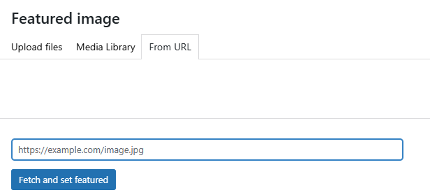

# Featured Image From URL

An open-source WordPress plugin by [Hashe Computer Solutions](https://hashe.com/) that adds an **Import from URL** workflow to the WordPress Media Library.

Paste a direct image URL; WordPress **downloads the file and saves it as a real Media Library attachment**. No hotlinking. Imported images can be selected, inserted, edited and reused like any image uploaded from your computer.

## Features

- **Add Media:** A **From URL** tab in the WordPress Media modal, for inserting images into posts and pages.
- **Featured Image:** Use the same tab in the Featured Image dialog to import and immediately set a post's featured image.
- **Media → Library:** An **Import from URL** action opens an import dialog from the full Media Library screen.
- **Normal WordPress attachments:** Original image files are stored in the site's uploads directory and registered in the Media Library, with WordPress's normal attachment metadata and responsive image sizes.
- **Classic and Block editors:** Supports the standard WordPress media modal and featured-image workflows. The plugin hooks select/post/manage media frames; third-party editors with wholly custom upload controls may require their own integration.
- **Safe handling:** User-capability and nonce checks, unsafe/private URL rejection through WordPress's safe HTTP APIs, limited redirects, 10 MB maximum streamed download, and validation of the downloaded image bytes.
- **Supported images:** JPEG, PNG, GIF and WebP. AVIF is accepted only if the WordPress installation recognizes AVIF uploads.
- **No featured-image side effect:** General Media Library imports do not modify a post's existing featured image.

## Requirements

- WordPress 5.8+.
- PHP 7.4+.
- An account with WordPress's **upload_files** permission.
- Internet access from the WordPress server to the source image URL.
- Post-edit permission when attaching an image to a post or setting its Featured Image.

## Installation

Download the **separate WordPress-installable ZIP asset** from [GitHub Releases](https://github.com/HasheCS/wp-featured-image-from-url/releases), then open **Plugins → Add New Plugin → Upload Plugin** and activate it.

Alternatively, copy the plugin directory to \`wp-content/plugins/featured-image-from-url/\` and activate it in WordPress.

This is a **regular WordPress plugin**, not a required MU-plugin. No changes to existing DataWatch or Hashe MU-plugins are part of this release.

## Usage

**From a post or page:** Click **Add Media** or **Set featured image**, open **From URL**, paste a direct URL, and click **Fetch image** or **Fetch and set featured image**. In the normal media dialog, the new attachment is selected for insertion. In the Featured Image dialog, it is assigned to the post.

**From Media → Library:** Click **Import from URL** near **Add New Media File**. Paste the URL to download it to the WordPress Media Library.

Only import images you have permission to use. Being able to access an image URL does not automatically grant reproduction rights.

## What's new in v1.1.0-rc.1 (testing candidate)

- Extended the original Featured Image tool into a **general Media Library URL importer**.
- Added support for media select/post/manage frames and a dedicated Media Library import entry point.
- Preserved the original AJAX action name and Featured Image workflow.
- Replaced hotlink-dependent responses with real WordPress attachment records and model selection.
- Introduced streaming size caps, source URL validation, actual image MIME detection, proper errors, and stricter capabilities.
- Removed the old demo video link; the video was about a much larger IT news workflow and did not accurately demonstrate this small plugin.

## Development and validation

See [tests](tests/) and [GitHub Actions](.github/workflows/ci.yml) for automated security and behavior checks. Before installing on a production website, back up the site and visually check the media modal in your active editor. Browser-specific compatibility with third-party custom editors is not guaranteed.

## License

[MIT](LICENSE.txt). Copyright Hashe Computer Solutions. Contributions welcome; see [CONTRIBUTING.md](CONTRIBUTING.md).
